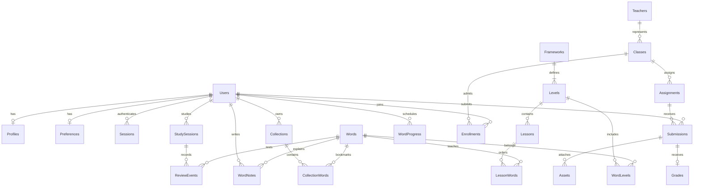

# XUEYAN — nghiệp vụ, SQL Server và phân quyền

> Cập nhật sau yêu cầu mới 24/10/2026: thêm tài khoản giảng viên và chặn đúng vai trò tại các không gian. Xem [phân quyền không gian](workspace-role-access.md); quyết định hai vai trò trong phần lịch sử dưới đây đã được thay thế.

Ngày thiết kế: 23/10/2026. Phạm vi chốt: ưu tiên UI web; database SQL Server; hai vai trò tài khoản **learner/admin**. Giáo viên là hồ sơ do admin quản lý, không phải tài khoản đăng nhập.

## Hiện trạng và quyết định

- Frontend Next.js có 38 route template. Chưa có `/admin`, backend API, phiên đăng nhập thật hoặc route guard. `/teacher/*` đang là màn hình mẫu, **không phải khu vực được bảo vệ**.
- Backend trước đợt này trống. Đã thêm schema, migration, RLS, các SQL role, thủ tục đổi quyền và kiểm thử SQL Server trong `backend/database/sqlserver/`.
- `frontend/` giữ giao diện. `data/` chỉ giữ nguồn HSK hiện có, không đặt code/UI/schema mới vào đó. Không sửa giao diện, không nối âm thầm dữ liệu DB vào các số liệu demo.
- Dữ liệu HSK nguồn là 3.0, nhưng fixtures UI có các con số cấp độ khác nhau. Không lấy tổng từ/tiến độ trên UI làm seed chính thức. Database tách **framework → level → word membership**, cho phép thêm phiên bản khác mà không trộn dữ liệu.
- Chưa thêm học phí, thanh toán, marketplace, tổ chức nhiều tenant hoặc tài khoản giáo viên. Đây không phải nghiệp vụ đã được xác nhận.

## Luồng nghiệp vụ và dữ liệu

| Nhóm UI / route có sẵn | Dữ liệu | Quy tắc nghiệp vụ |
| --- | --- | --- |
| `/`, `/about`, `/help`, `/resources`, `/resources/[slug]` thực tế hiện chỉ có `remember-vocabulary` | Articles, danh mục công khai | Chỉ nội dung đã xuất bản; không lộ bài nháp hoặc thông tin phòng học. `Articles.Kind` phân biệt bài viết/tài nguyên/trợ giúp/giới thiệu. Không biến một bài viết mới thành route đã tồn tại. |
| `/login`, `/register`, `/forgot-password`, `/reset-password` | Users, PasswordCredentials, Sessions, OneTimeTokens | Đăng ký luôn là learner, không nhận role từ form; email chuẩn hóa duy nhất; chỉ hash mật khẩu/token; token có hạn dùng, reset/email token dùng một lần. Auth/API cần triển khai riêng. |
| `/onboarding`, `/profile/edit`, `/settings` | Profiles, Preferences | Một bộ hồ sơ/cài đặt mỗi tài khoản; lưu giờ cụ thể và IANA timezone. Onboarding cập nhật cùng Preferences, không tạo một hồ sơ mục tiêu khác. Draft thiết bị hiện có vẫn là local, không đồng nghĩa lưu server. |
| `/vocabulary`, `/vocabulary/[level]`, `/lessons/1` | Frameworks, Levels, Words, WordLevels, Examples, Lessons, LessonWords | Nhiều ví dụ và cách đọc; không unique chữ Hán một mình vì có từ đa âm/đa nghĩa. Thứ tự từ trong bài rõ ràng; từ đang tiếp tục phải thuộc bài đó. |
| `/lessons/1/learn`, `/review/study`, `/lessons/1/practice`, `/review/summary` | StudySessions, ReviewEvents, WordProgress, LessonProgress | Phân biệt học/ôn/luyện tập; hoàn thành khác thoát sớm. Sự kiện có id chống retry trùng; kết quả phiên tính từ sự kiện thực. SRS có phiên bản thuật toán và trạng thái riêng, không lấy fixture làm lịch ôn. |
| `/dashboard`, `/progress` | Tổng hợp các bảng học | Số từ đã học theo UserId+WordId, từ đến hạn theo NextReviewAt, thời gian từ event có giới hạn hợp lệ. Streak theo ngày trong timezone người học, không theo ngày máy chủ. Không lưu riêng các số 248 từ/89,2%/7 ngày mẫu. |
| `/dictionary`, `/collection`, `/collection/[id]` | PublishedWords/Examples, WordNotes, Collections, CollectionWords | Ghi chú riêng theo người+ từ; tên bộ từ không trống, unique theo chủ sở hữu sau chuẩn hóa; bộ lọc “Tất cả/HSK/Từ cần củng cố” là truy vấn, không tự tạo thành bộ từ DB. |
| `/teachers`, `/teachers/[id]` | Teachers | Giáo viên không có PasswordCredentials/role riêng. Hồ sơ công khai chỉ lấy trạng thái published. Bằng cấp chưa xác minh không được seed thành thông tin thật. |
| `/teachers/[id]/consultation` | ConsultationRequests | Yêu cầu có người gửi, giáo viên và thông tin liên hệ; gửi yêu cầu không đồng nghĩa đã đặt được lịch. Admin xử lý pending→contacted→scheduled/closed/cancelled. |
| `/classes`, `/classes/hsk2-k24` | Classes, Enrollments | Người học chỉ thấy phòng học/lịch nội bộ của lớp đã ghi danh; không tự thêm enrollment. Danh mục public không chứa MeetingUrl. |
| `/assignments/4` | Assignments, Submissions, Assets | Bài nộp phải thuộc bài tập trong đúng lớp đã ghi danh. Mỗi lần nộp là AttemptNo riêng; draft có thể chưa đủ chữ, submit mới kiểm tra số chữ Hán/hạn nộp/trạng thái lớp. Sau submit không tự sửa điểm hoặc nội dung đã nộp. |
| `/teacher/*` mẫu hiện tại | Teachers, Classes, Assignments, Grades | Giai đoạn hai role: các tác vụ quản lý/chấm bài dành cho admin. Giữ thiết kế tham khảo; đề xuất ánh xạ vào admin workspace khi triển khai guard/UI admin, chưa đổi route ở đợt DB này. |
| `/notifications`, `/contact` | Notifications, SupportRequests | Chỉ đọc thông báo của mình; learner chỉ đổi ReadAt. Support công khai cần endpoint kiểm tra dữ liệu/rate limit; không cấp anonymous quyền insert trực tiếp DB. |

## Ma trận quyền

`guest` dưới đây là kết nối đọc nội dung công khai, **không phải vai trò tài khoản thứ ba**.

| Tài nguyên/hành động | Khách | Người học | Admin |
| --- | --- | --- | --- |
| Từ/bài học/bài viết/hồ sơ giáo viên đã xuất bản | Đọc qua view | Đọc qua view | Quản lý draft/publish/archive |
| Hồ sơ, cài đặt, ghi chú, sổ từ | Không | Đọc/sửa dữ liệu của mình | Quản lý; cần lý do và audit khi làm API hỗ trợ |
| Tiến độ, sự kiện ôn, kết quả | Không | Đọc của mình; gửi đáp án qua API đã kiểm tra | Quản lý theo nghiệp vụ, không lấy điểm client làm nguồn tin cậy |
| Lớp học/phòng học/bài tập | Chỉ danh mục public | Đọc lớp mình đã ghi danh | Quản lý |
| Enrollment, điểm, xuất bản nhận xét | Không | Không tự ghi | Quản lý |
| Bài nộp | Không | Đọc của mình, draft/submit qua command server | Đọc/chấm/trả bài |
| Tư vấn/hỗ trợ | Qua endpoint gửi yêu cầu sau này | Gửi/đọc của mình qua API | Xử lý yêu cầu |
| Thông báo | Không | Đọc của mình, đánh dấu đã đọc | Tạo/quản lý |
| Vai trò/trạng thái tài khoản | Không | Không | Qua `auth.SetUserAccess`; không được vô hiệu hóa admin hoạt động cuối cùng |
| PasswordHash/token phiên/reset | Không | Không | SQL role admin cũng không được đọc trực tiếp |
| Audit | Không | Không | Đọc; ghi role-change trong thủ tục, chưa có audit mọi API |

## Mô hình quan hệ cốt lõi

## Phân quyền thực thi và ranh giới bảo mật

SQL Server roles: `xueyan_guest`, `xueyan_learner`, `xueyan_admin`. Không tạo SQL login/mật khẩu dùng chung hay mặc định. Không cấp `db_owner` cho runtime. Người dùng website không kết nối SQL trực tiếp.

Các bảng cá nhân dùng **RLS filter + block**: đọc/sửa/xóa khác chủ sở hữu bị lọc; insert/update đổi chủ sở hữu bị chặn. Điểm nháp chưa xuất bản không hiển thị cho học viên. Composite FK chặn gắn từ của bộ A dưới chủ B, event vào phiên của người khác, hoặc bản nộp vào enrollment khác lớp.

Identity của RLS lấy hash token phiên từ `SESSION_CONTEXT('session_token_hash')` và đối chiếu `auth.Sessions` + tài khoản active + role DB tương ứng. Không tin `user_id` hoặc `role` trong SESSION_CONTEXT/body/localStorage. Người có quyền SQL learner không được đọc/create sessions để tự chọn một user khác. Token ngẫu nhiên đủ mạnh, hash SHA-256 phía server; hash cũng cần được coi như bí mật vì dùng làm context xác thực. Không log hoặc gửi hash cho browser.

API sau này phải xác thực cookie phiên HttpOnly, lấy **kết nối riêng đúng role**, set context ngay khi checkout và xóa trong finally trước khi trả pool. Kết nối admin vốn được cấp quyền quản lý catalog; vì vậy vẫn phải kiểm tra session/admin ở API cho **mọi command**, không coi RLS cá nhân là guard toàn hệ thống. Không chia sẻ pool admin cho request learner; không set role theo field do client gửi. Các hàm schema-bound thực hiện lookup mà không mở SELECT vào bảng bí mật cho runtime.

SQL role learner không có quyền ghi trực tiếp tiến độ, enrollment, điểm, bản nộp hoặc sessions; command server được kiểm tra nghiệp vụ là bước tiếp theo. Chưa thêm API/auth/guard trong đợt này, do đó UI hiện tại vẫn là demo công khai. **Không tuyên bố website đã đăng nhập/phân quyền hoàn chỉnh chỉ vì database có role/RLS.**

`auth.SetUserAccess` ghi audit, thu hồi phiên của tài khoản bị thay quyền/trạng thái và khóa kiểm tra admin cuối. Thủ tục tự quản lý transaction; khi bị chặn sẽ rollback transaction đang bao ngoài, nên API gọi như command độc lập. Bootstrap admin đầu tiên phải qua migration/operator tin cậy sau khi có auth thật; không có admin/admin123 hay tài khoản ẩn trong seed.

Tài liệu cơ chế: [Microsoft RLS](https://learn.microsoft.com/en-us/sql/relational-databases/security/row-level-security?view=sql-server-ver17), [SESSION_CONTEXT](https://learn.microsoft.com/en-us/sql/t-sql/functions/session-context-transact-sql?view=sql-server-ver17). Dùng SQL Server 2022 và bản cập nhật bảo mật phù hợp khi triển khai.

## Ràng buộc và vận hành

- Chuỗi người dùng/chữ Hán/Pinyin là `nvarchar`, literal `N'…'`; database có collation hỗ trợ supplementary characters. Không unique Han đơn lẻ; giữ cách đọc và nguồn. Import HSK là đợt riêng: parser theo file, dedup theo nguồn/cách đọc, lưu bản nháp chờ soát nghĩa tiếng Việt và level rồi mới publish.
- UTC dùng `datetime2(3)`; giờ học dùng `time(0)`, timezone dùng IANA ID. Server xác nhận timezone thuộc allowlist, email/URL hợp lệ, chuẩn hóa Unicode whitespace và enum nghiệp vụ; DB có FK/CHECK/unique như lớp bảo vệ thứ hai.
- `rowversion` cho optimistic concurrency trên hồ sơ/cài đặt/nháp/điểm; API cần `WHERE Version=@ExpectedVersion`, trả conflict thay vì ghi đè im lặng. `UpdatedAt` cần được set trong command, không có trigger tự cập nhật mọi bảng.
- Retry review dùng unique `(UserId,ClientEventId)`; server ghi event và cập nhật scheduler trong cùng transaction. Scheduler chưa được lựa chọn/triển khai; không lưu phần trăm ghi nhớ giả vào DB.
- Không cascade-delete toàn bộ lịch sử học. Archive nội dung; yêu cầu xóa tài khoản cần quy trình retention/anonymization riêng. Không có backup/restore production trong đợt này.
- File chỉ có metadata/storage key; không nhị phân/localStorage. Tải file cần kiểm tra owner/lớp/scan và URL có hạn từ API. `Assets` hiện mô hình file cá nhân/bài nộp, chưa phải kho tài liệu lớp học hoàn chỉnh.
- Bài tập có min/max chữ Hán nhưng SQL không đếm bằng LEN (vì Pinyin/dấu câu không phải chữ Hán); command submit kiểm tra chữ Hán, trạng thái enrollment/lớp/bài tập và hạn nộp. Phát hành điểm yêu cầu score, người chấm admin và bài đã nộp. Các check workflow này còn chờ API.

## Tiếp tục UI mà không làm lệch nghiệp vụ

1. Hoàn thiện luồng học/ôn và trạng thái dữ liệu trên UI hiện có; tiếp tục ghi rõ demo và bản nháp thiết bị. Giữ phong cách Dashboard/Stitch.
2. Thiết kế UI admin theo nghiệp vụ đã chốt: người dùng, từ vựng/bài học, nội dung, hồ sơ giáo viên/lớp/bài tập, chấm bài, tư vấn/hỗ trợ. Đây là danh sách đề xuất, chưa tạo route mới.
3. Chốt backend/API và auth session; nối account/ownership/guard trước khi thay nhãn demo bằng dữ liệu thật. Không thêm nút chuyển sang admin dựa trên localStorage.
4. Import HSK có kiểm duyệt, nối từng nhóm màn hình vào API; kiểm thử hai tài khoản và admin trên trình duyệt. Khối chưa có API giữ trạng thái chưa khả dụng rõ ràng.
